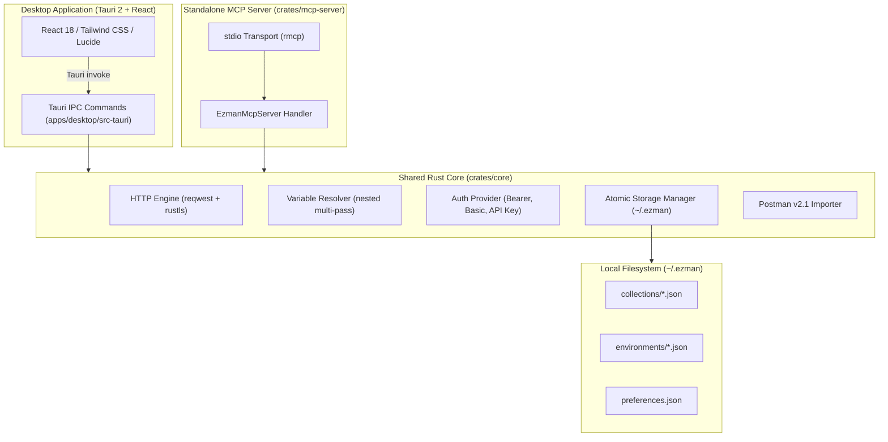

# ezman ⚡

A lightweight, fast, and extensible desktop API client and local Model Context Protocol (MCP) server designed as a minimal, bloat-free alternative to Postman.

Built with **Tauri 2**, **React**, **TypeScript**, **Tailwind CSS**, **Lucide Icons**, and **Rust**.

---

## Key Highlights

- **Shared Rust Request Engine:** Both the desktop client and the standalone MCP server share the identical underlying Rust engine (`ezman-core`), guaranteeing zero divergence in variable substitution, authentication, headers, and HTTP execution.
- **MCP Server for AI Coding Assistants:** Expose your local collections and environments directly to **Cursor**, **Claude Code**, and **Codex** over standard `stdio`.
- **Fast & Minimal Footprint:**
  - MCP Server starts in **< 10ms** and idles at **< 9 MB RAM**.
  - Desktop client launches in **< 0.5s** and idles at **~70 MB RAM** (vs 500MB–1GB+ in Electron-based clients).
- **Postman v2.1 Collection Import:** Seamlessly import existing collections with nested folders, query parameters, request headers, bodies, and variables. Gracefully warns about unsupported features (like Postman pre-request/test scripts).
- **Safe & Atomic Local Persistence:** Stored locally in `~/.ezman/` using atomic writes (`.tmp` + rename) and cross-process advisory file locking (`fs2`).
- **Secret Sanitization:** Sensitive authentication credentials and variables marked as secrets are automatically redacted/masked in UI displays, MCP tool responses, and logs.
- **Zero Cloud & Zero Telemetry:** Completely offline-first with no accounts, logins, or external tracking.

---

## Architecture Overview



### Shared Engine Philosophy
Instead of executing requests in the browser or JavaScript layer, all HTTP traffic, variable interpolation (`{{baseUrl}}`), and authentication logic are executed directly in Rust via `reqwest` 0.12. When an AI tool issues an `execute_request` tool call via the MCP server, it invokes the exact same execution pipeline that runs when you click **Send** in the desktop application.

---

## Performance Benchmarks

Measured on macOS (Apple Silicon, Production Release Builds):

| Metric | Postman (Typical) | `ezman-desktop` | `ezman-mcp` (MCP Server) |
| :--- | :--- | :--- | :--- |
| **Cold Startup Time** | 4.0 – 8.0 s | **~0.4 s** | **~7.3 ms** |
| **Warm Startup Time** | 2.5 – 5.0 s | **~0.3 s** | **~8.9 ms** |
| **Idle Memory (RSS)** | 450 – 900+ MB | **~71.4 MB** | **~8.8 MB** |
| **Binary Size** | ~350 MB (App bundle) | **15 MB** (native binary) | **9.2 MB** (standalone binary) |
| **Cloud Dependency** | Mandatory / Cloud-first | **100% Offline / Local** | **100% Offline / Local** |
| **Telemetry / Tracking** | Extensive | **None** | **None** |

---

## Features

### 1. Desktop Application
- **Request Builder:**
  - Methods: `GET`, `POST`, `PUT`, `PATCH`, `DELETE`, `HEAD`, `OPTIONS`.
  - Query parameters sync table with individual enable/disable checkboxes.
  - Header presets (JSON, Form, XML) and custom header management.
  - Authentication: Inherit from collection, Bearer Token, Basic Auth, API Key (Header or Query param), or None.
  - Request Body powered by **Monaco Editor**:
    - **JSON**: Full Monaco Editor with syntax linting, bracket matching, code folding, and auto-formatting.
    - **Raw Text**: Monaco Editor supporting plain text and code payloads.
    - **Native GraphQL**: Dedicated Monaco editor with custom Monarch syntax highlighting for queries, mutations, and subscriptions, plus a second Monaco editor for JSON Variables with formatting and validation.
    - **URL-encoded**: Dynamic key-value form table with toggleable checkboxes.
- **Response Inspector:**
  - Status badge (color-coded with status description).
  - Roundtrip latency in milliseconds and payload size (formatted in B, KB, or MB).
  - Powered by read-only **Monaco Editor** with automatic language detection (`JSON`, `HTML`, `XML`, `CSS`, `JavaScript`, `Markdown`, `PlainText`), line numbers, code folding, word wrap toggle, and in-editor search (`⌘F` / `Ctrl+F`).
  - Pretty JSON formatting and Raw text toggle.
  - Filterable response headers table and one-click clipboard copy.
- **Multi-Tab Workspace:**
  - Dirty state tracking (visual indicator on modified unsaved tabs).
  - Keyboard shortcuts:
    - `⌘ / Ctrl + Enter`: Execute active request.
    - `⌘ / Ctrl + S`: Save active request.
    - `⌘ / Ctrl + W`: Close current tab.
    - `⌘ / Ctrl + T`: Open a new blank request tab.
- **Environments & Variables:**
  - Multi-pass nested variable substitution: `{{baseUrl}}/api/v1/{{resource}}`.
  - Supports variable interpolation in URLs, headers, auth tokens, JSON bodies, and GraphQL queries/variables (`{{variable}}`).
  - Precedence hierarchy: Environment variables override Collection variables.
  - Secret masking with quick reveal toggles.
- **Postman v2.1 Importer:**
  - Imports nested folders recursively.
  - Full variable, header, query parameter, GraphQL body, and raw body preservation.
  - Transparent warning notifications for unsupported Postman features (scripts, unsupported auth types).

### 2. Model Context Protocol (MCP) Server
The standalone `ezman-mcp` binary implements the Model Context Protocol using `stdio` transport. It enables AI coding assistants to view collections and execute API requests directly against your local configurations.

#### Available MCP Tools:
1. `list_collections`: Lists all saved collections with IDs, names, and request counts.
2. `list_requests`: Lists all requests within a collection (filtering by folder optionally), showing IDs, names, HTTP methods, and URLs.
3. `get_request`: Retrieves full details of a specific request. All authorization headers and secret tokens are sanitized and redacted.
4. `list_environments`: Lists available environments with variable names. Variable values marked as secrets are automatically masked (`••••••••`).
5. `execute_request`: Resolves variables, applies auth, and executes the HTTP request through `ezman-core`.
   - **Environment Safety Rule:** When environments exist in storage, `execute_request` strictly requires an explicit `environment_id` (or explicitly `"none"`), preventing accidental execution against unintended environments (e.g. production).
   - **Mutation Detection:** Flags potentially mutating HTTP methods (`POST`, `PUT`, `PATCH`, `DELETE`) with a safety annotation.

---

## MCP Configuration Guide

### 1. Cursor (`.cursor/mcp.json` or `~/.cursor/mcp.json`)

To enable `ezman` in Cursor, add the server to your Cursor MCP settings file:

```json
{
  "mcpServers": {
    "ezman": {
      "command": "/path/to/ezman/target/release/ezman-mcp",
      "args": []
    }
  }
}
```

> **Tip:** Replace `/path/to/ezman/target/release/ezman-mcp` with the absolute path to your compiled binary or installed binary location (e.g. `/usr/local/bin/ezman-mcp`).

### 2. Claude Code CLI

Add `ezman-mcp` to Claude Code using the `claude mcp add` command:

```bash
claude mcp add ezman -- /path/to/ezman/target/release/ezman-mcp
```

Or add it directly to your `~/.claude.json` configuration file:

```json
{
  "mcpServers": {
    "ezman": {
      "command": "/path/to/ezman/target/release/ezman-mcp",
      "args": []
    }
  }
}
```

### 3. Codex & Generic stdio MCP Clients

For any client supporting stdio MCP servers:

```json
{
  "name": "ezman",
  "command": "/path/to/ezman/target/release/ezman-mcp",
  "args": [],
  "env": {
    "RUST_LOG": "info"
  }
}
```

---

## Building and Running

### Prerequisites

- [Rust](https://rustup.rs/) (1.80 or newer)
- [Node.js](https://nodejs.org/) (v18 or newer) and `npm`

### 1. Build the Entire Workspace

```bash
# Clone the repository
git clone https://github.com/example/ezman.git
cd ezman

# Install frontend dependencies
cd apps/desktop
npm install
cd ../..

# Build all Rust crates in release mode
cargo build --release
```

The release binaries will be placed in:
- `target/release/ezman-desktop` (Desktop Application)
- `target/release/ezman-mcp` (Standalone MCP Server)

### 2. Run in Development Mode

```bash
# Run the Desktop Application in development
cd apps/desktop
npm run tauri dev

# Or run frontend in browser mode for quick UI styling:
npm run dev

# Run the MCP Server directly in development
cargo run -p ezman-mcp-server
```

### 3. Run Tests

```bash
# Run all unit and integration tests across the workspace
cargo test --workspace

# Run core library tests
cargo test -p ezman-core

# Run MCP server tests
cargo test -p ezman-mcp-server
```

---

## Directory Structure

```
ezman/
├── Cargo.toml                     # Workspace root Cargo manifest
├── Cargo.lock
├── README.md                      # This documentation
├── examples/
│   └── postman_collection_v2.1_sample.json  # Postman sample collection for verification
├── crates/
│   ├── core/                      # Shared Rust Core
│   │   ├── src/
│   │   │   ├── auth/              # Bearer, Basic, API Key authentication
│   │   │   ├── collection/        # Importer & collection management
│   │   │   ├── env/               # Nested variable interpolation
│   │   │   ├── http/              # Reqwest execution engine & timing
│   │   │   ├── storage/           # Atomic file storage with advisory locks
│   │   │   ├── error.rs           # CoreError definitions
│   │   │   ├── model.rs           # Shared domain models & sanitization
│   │   │   └── lib.rs
│   │   └── tests/
│   │       └── http_engine_test.rs
│   └── mcp-server/                # Standalone MCP Server
│       ├── src/
│       │   ├── main.rs            # Stdio entrypoint
│       │   ├── server.rs          # rmcp ServerHandler implementation
│       │   └── lib.rs
│       └── tests/
│           └── mcp_test.rs
└── apps/
    └── desktop/                   # Tauri 2 Desktop Application
        ├── src/                   # React + TypeScript Frontend
        │   ├── components/        # UI components (Editor, Viewer, Sidebar, Modals)
        │   ├── services/          # Tauri IPC bridge & API client
        │   ├── types/             # Strict TypeScript domain interfaces
        │   ├── App.tsx            # Main layout & state orchestration
        │   └── index.css          # Tailwind CSS styling
        └── src-tauri/             # Tauri 2 Rust wrapper
            ├── capabilities/      # Tauri permission capabilities
            ├── icons/             # RGBA application icons
            ├── src/
            │   ├── lib.rs         # Tauri commands dispatching to ezman-core
            │   └── main.rs
            └── tauri.conf.json    # Tauri application configuration
```

---

## License

MIT License. Designed and built for developer speed, privacy, and seamless AI workflow integration.
